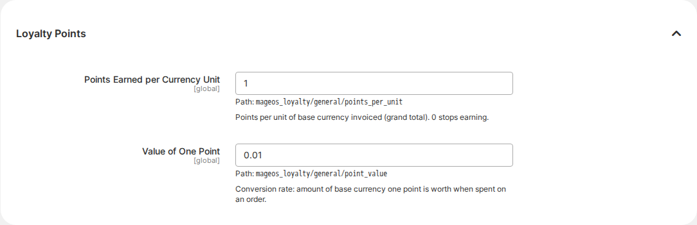

# Loyalty Points

`mage-os/module-loyalty` (`MageOS_Loyalty`) — a module for Mage-OS / Magento Open Source.

Customers earn points on invoiced orders and spend them in the cart at a rate set in the admin.

- Configuration: *Stores > Configuration > Customers > Loyalty Points* (points earned per unit of base currency invoiced, and the base currency value of one point).
- Logged-in customers choose in the cart how many points to use. The amount is deducted from the grand total, capped by their balance and by the total.
- Points are spent atomically when the order is placed, returned on cancellation or credit memo, and earned points are taken back on refunds.
- Customers see their balance and history under *My Account > Loyalty Points*.
- The loyalty line is shown in cart totals, the checkout summary, order views, the order e-mail and admin invoices / credit memos.

Limitations: no multi-address checkout, no admin screen to adjust balances, and no integration with Hyvä Checkout.

## Compatibility

Mage-OS 3.6 and 4.x, and Magento Open Source 2.4.9: all share the Magento 2.4.9 base (`magento/framework` ^103.0.9). PHP 8.3 to 8.5. CI runs the check-extension workflow on the currently supported Mage-OS versions (today Mage-OS 3.6.0 with PHP 8.4; Mage-OS 4.0 joins once the check-extension actions know it); developed on Mage-OS 4.0.0 with PHP 8.5. Storefront: Hyvä default theme (1.5) and Luma; Hyvä Checkout and GraphQL are not supported.

## Installation

```bash
composer config repositories.mageos-loyalty vcs https://github.com/mage-os-lab/module-loyalty
composer require mage-os/module-loyalty
bin/magento module:enable MageOS_Loyalty
bin/magento setup:upgrade
```

## Configuration

### Stores > Configuration > Customers > Loyalty Points > Loyalty Points

| Setting | Default | Scope | What it does |
|---------|---------|-------|--------------|
| Points Earned per Currency Unit | 1 | Global | Points per unit of base currency invoiced, on the invoice grand total, rounded down. 0 stops earning. |
| Value of One Point | 0.01 | Global | Base currency amount one point is worth when spent in the cart. |

Access to this section needs the *Loyalty Points* ACL resource.



## Getting started

1. Keep the defaults: 1 point per currency unit, 1 point = 0.01.
2. As a logged-in customer, place an order of 100 and invoice it: the customer gets 100 points, shown under *My Account > Loyalty Points*.
3. In the next cart the customer enters the points to use; 100 points take 1.00 off the grand total.

Guests neither earn nor spend points.

## Troubleshooting

- **No points after an order**: points are earned on the invoice, not on order placement, and only for logged-in customers.
- **"Your loyalty points balance has changed" at checkout**: the balance was spent in another order meanwhile; the customer must choose the points again.

## More

- [CHANGELOG](CHANGELOG.md)
- [Security policy](SECURITY.md)
- [License](LICENSE.txt): Open Software License 3.0. This module contains no code from Adobe Commerce.
